<div align="center">

# OpenCode Mobile

**A native Android client for [OpenCode Go](https://opencode.ai/docs/console/go/).**
Chat with GLM, Kimi, DeepSeek, Qwen, MiniMax and more from your phone, in the same monochrome, monospace style as OpenCode.


[](https://github.com/jaggerjack61/OpenCodeMobile/releases/latest)
[](LICENSE)

**[⬇ Download the latest APK](https://github.com/jaggerjack61/OpenCodeMobile/releases/latest)**

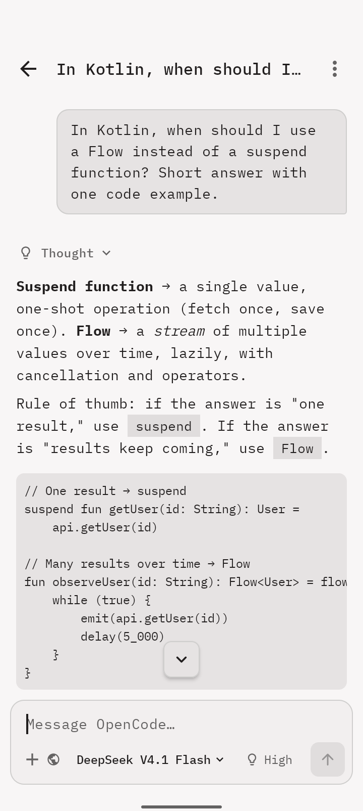&nbsp;
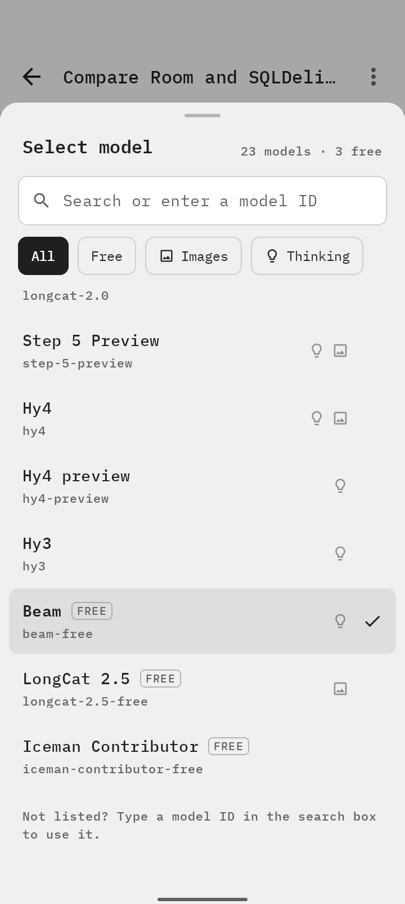&nbsp;
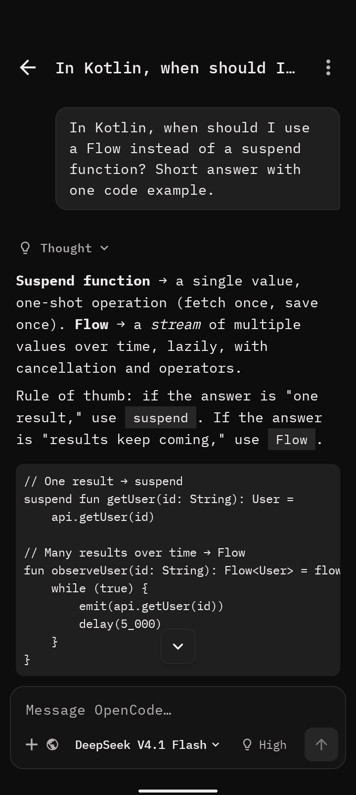

</div>

---

## Contents

- [Highlights](#highlights)
- [Tour](#tour)
- [Getting started](#getting-started)
- [Releases](#releases)
- [Using the app](#using-the-app)
- [Building from source](#building-from-source)
- [Configuration](#configuration)
- [Privacy and security](#privacy-and-security)
- [Architecture](#architecture)
- [Troubleshooting](#troubleshooting)
- [Contributing](#contributing)
- [License](#license)

## Highlights

- **Streaming chat** with Markdown rendering: headings, lists, tables, inline code and scrollable code blocks.
- **The live OpenCode Go model list**, fetched from OpenCode and cached on the device, so new and retired models show up without an app update. Search it, filter it by Free, Images or Thinking, or type any model ID.
- **Free models**: models that OpenCode Go serves for free are tagged **FREE** and have their own filter. They keep working after you reach your plan's usage limit.
- **Thinking effort per chat**: Auto, None, Minimal, Low, Medium, High, Extra high or Max, limited to the levels each model supports.
- **Picks up where you left off**: a new chat starts with the model and thinking effort you used last.
- **Visible reasoning and tool steps**: collapsible *Thought*, *Searched* and *Ran* rows show what the model did before it answered.
- **Web search**: the model can search the web and cite sources. No search API key is needed.
- **Optional shell tool**: runs `sh` commands in a sandboxed, app-private workspace. Off by default.
- **Image and audio attachments** for models that accept them.
- **Usage dashboard** with your 5-hour, weekly and monthly OpenCode Go limits and reset countdowns.
- **Private by design**: your API key is encrypted with the Android Keystore, and conversations never leave the device except to talk to the model.
- **Light, dark and system themes**, set in IBM Plex Mono with OpenCode's squared, hairline look.

## Tour

### Chat

<table>
  <tr>
    <td align="center">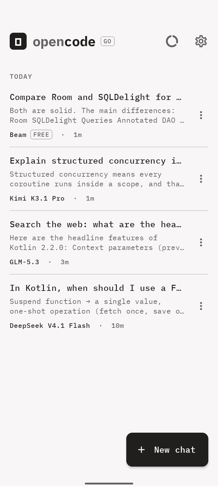</td>
    <td align="center">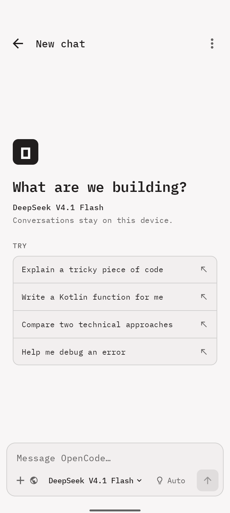</td>
    <td align="center">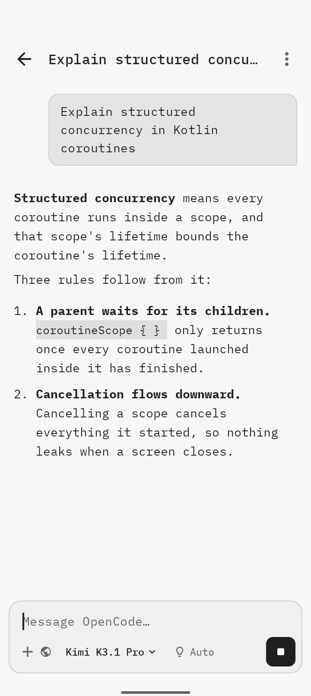</td>
  </tr>
  <tr>
    <td align="center"><sub>Conversations grouped by day, newest first</sub></td>
    <td align="center"><sub>Start a chat or pick a suggestion</sub></td>
    <td align="center"><sub>Responses stream in live; tap ■ to stop</sub></td>
  </tr>
</table>

### Models and per-chat controls

<table>
  <tr>
    <td align="center">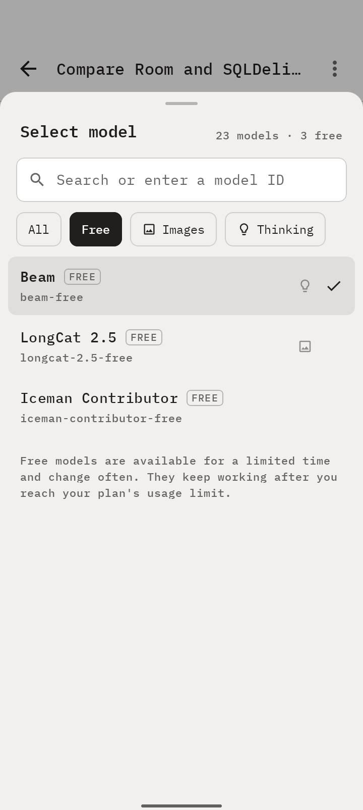</td>
    <td align="center">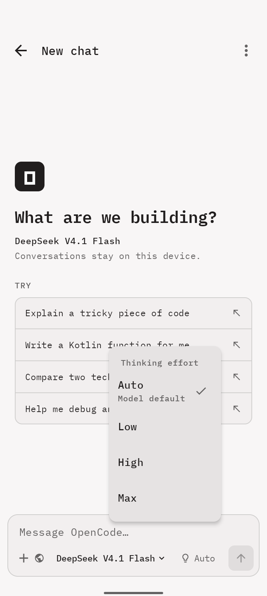</td>
    <td align="center">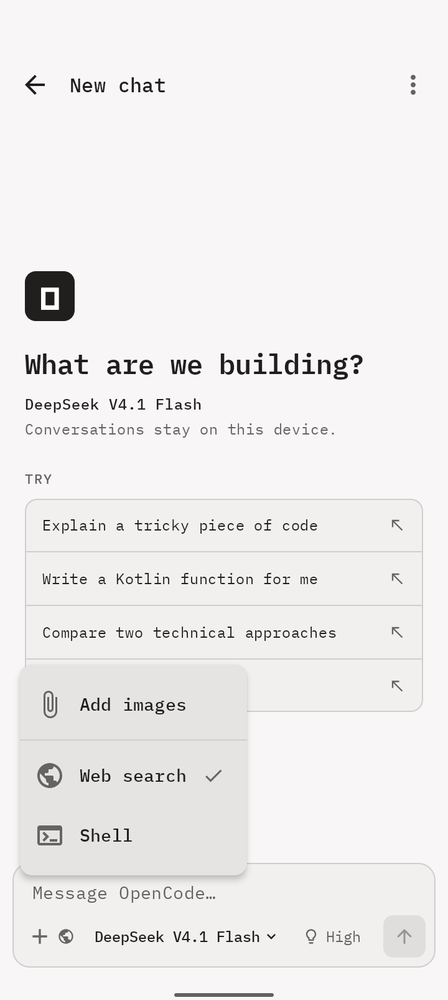</td>
  </tr>
  <tr>
    <td align="center"><sub>Filter the model list to the free models</sub></td>
    <td align="center"><sub>Effort levels offered by the current model</sub></td>
    <td align="center"><sub>Attach media and toggle tools per chat</sub></td>
  </tr>
</table>

### Reasoning, usage and settings

<table>
  <tr>
    <td align="center">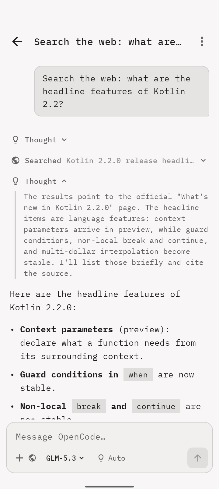</td>
    <td align="center">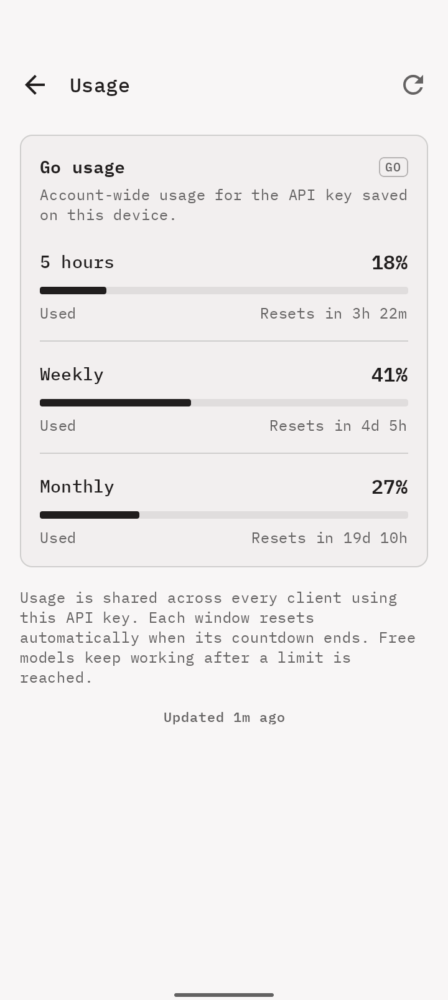</td>
    <td align="center">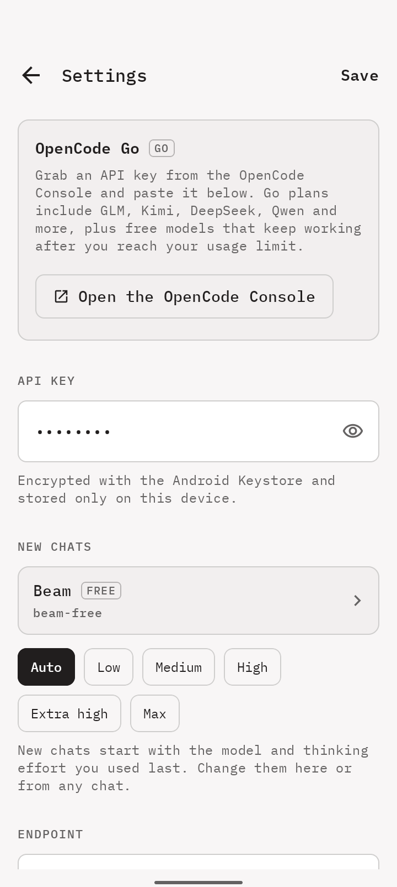</td>
  </tr>
  <tr>
    <td align="center"><sub>Expand any step to read the reasoning or tool output</sub></td>
    <td align="center"><sub>Rolling plan limits with reset countdowns</sub></td>
    <td align="center"><sub>API key, new-chat model, endpoint and theme</sub></td>
  </tr>
</table>

### Dark theme

<table>
  <tr>
    <td align="center">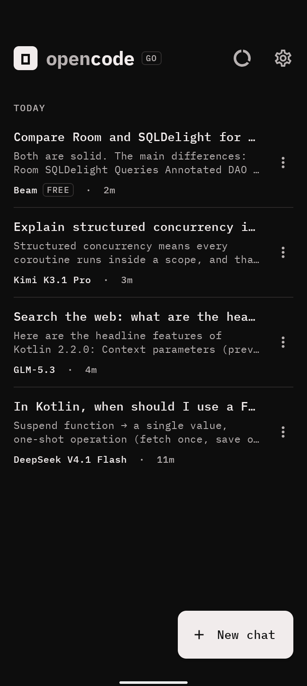</td>
  </tr>
  <tr>
    <td align="center"><sub>Chats grouped by day</sub></td>
  </tr>
</table>

> The screenshots show sample conversations served by a local test endpoint, not live model output.

## Getting started

### Requirements

- An Android phone running **Android 8.0 (API 26)** or newer.
- An active **OpenCode Go** or **Go Plus** subscription, and an API key from the [OpenCode Console](https://opencode.ai/console). The free models are served through Go too, so they also need the subscription.

### Install

1. On your phone, open the [latest release](https://github.com/jaggerjack61/OpenCodeMobile/releases/latest) and download `OpenCodeMobile-vX.Y.Z.apk`.
2. Open the downloaded file. If Android asks, allow your browser or file manager to **install unknown apps**.
3. Tap **Install**.

To install from a computer instead, run `adb install OpenCodeMobile-vX.Y.Z.apk`. To build it yourself, see [Building from source](#building-from-source).

### First run

1. Open the app and tap **Add your API key to get started**, or the ⚙ icon.
2. Paste your OpenCode API key and tap **Save**. **Test connection** checks that the key and endpoint work.
3. Go back, tap **New chat**, and send a message.

## Releases

Signed APKs are published on the [Releases page](https://github.com/jaggerjack61/OpenCodeMobile/releases). Each release lists its changes and the APK's SHA-256 checksum.

| Version | Date | Highlights |
| --- | --- | --- |
| [v1.1.0](https://github.com/jaggerjack61/OpenCodeMobile/releases/tag/v1.1.0) | 2026-11-10 | Live model list with free models, new chats remember the last model and effort, refreshed OpenCode-style UI |
| [v1.0.0](https://github.com/jaggerjack61/OpenCodeMobile/releases/tag/v1.0.0) | 2026-10-20 | First public release |

### Verify a download

Check the APK against the checksum in the release notes:

```bash
shasum -a 256 OpenCodeMobile-v1.1.0.apk      # macOS / Linux
certutil -hashfile OpenCodeMobile-v1.1.0.apk SHA256   # Windows
```

Every official release is signed with the same certificate:

```text
SHA-256: 5C:C4:36:06:50:9D:B8:5D:FB:80:14:95:83:BF:90:0B:EF:84:79:87:72:AC:4B:92:58:5C:E0:37:41:2A:11:A5
```

To check it, run `apksigner verify --print-certs OpenCodeMobile-v1.1.0.apk` from the Android SDK build-tools.

### Updating

Install a newer release over the existing app. Your conversations and settings are kept. Android only allows this when the signing certificate matches, so you can't update an official release with a build you signed yourself, or the other way round. To switch between them, uninstall first. This deletes your local conversations.

## Using the app

| To… | Do this |
| --- | --- |
| Start a conversation | Tap **New chat** on the home screen. The first message becomes the title. |
| Switch model | Tap the model name in the composer, then search, scroll or filter by **Free**, **Images** or **Thinking**. Icons show thinking (💡), image and audio support. |
| Use a free model | Open the model list and tap **Free**. Free models carry a **FREE** tag everywhere they appear. |
| Use a model that isn't listed | Type its ID in the model search box and tap **Use "…"**. |
| Change thinking effort | Tap the 💡 chip next to the model name. It's hidden for models with no effort options. |
| Turn web search or shell on or off | Tap **+** in the composer. Active tools appear as icons next to the **+**. |
| Attach images or audio | Tap **+** then **Add images** (or audio). This only appears when the model accepts that media. |
| Inspect reasoning or tool output | Tap a **Thought**, **Searched** or **Ran** row. |
| Copy a response | Tap the copy icon under the answer. |
| Stop or retry | Tap ■ while streaming. If a request fails, tap **Try again**. |
| Check plan usage | Tap the usage ring on the home screen, or ⋮ → **Usage** in a chat. |
| Delete a chat | Tap ⋮ on the chat in the list, or ⋮ → **Delete chat** inside it. |

Model, effort and tool choices are saved per conversation. A new chat starts with the model and thinking effort you used last; you can also change them under **New chats** in Settings.

### Tools

- **Web search** is on by default for new chats. The model calls `web_search`, and the app queries Brave Search (falling back to DuckDuckGo Instant Answers) and returns titles, URLs and snippets. The model is told to avoid duplicate searches. After five tool rounds, the app asks for a final answer with tools disabled, so a chat can't loop forever.
- **Shell** is off by default and needs confirmation to enable. The model can call `shell`, which runs `/system/bin/sh` in the app-private `workspace` directory. Each command has a 20-second timeout, output is capped at 16,000 characters, and the exit code is reported. Android doesn't ship `bash`, `git`, `python` or `curl`.

### Attachments

Images are resized and compressed, then sent as `image_url` data URLs. WAV and MP3 audio is sent as `input_audio`. Attachments are stored in app-private storage and deleted together with their conversation. If you switch a chat to a model with different media support, attachments it can't read stay visible in the history but are left out of requests.

## Building from source

### Prerequisites

| Tool | Version |
| --- | --- |
| JDK | 17 or newer |
| Android SDK | Platform 36 (compile and target), build-tools 36 |
| Gradle | 8.14.3 (via the included wrapper) |
| Android Gradle Plugin | 8.13.2 |
| Kotlin | 2.2.10 |

Open the project in Android Studio, or point `local.properties` at your SDK:

```properties
sdk.dir=/path/to/Android/sdk
```

### Debug build

```bash
./gradlew :app:assembleDebug
# → app/build/outputs/apk/debug/app-debug.apk
```

### Tests

```bash
./gradlew :app:testDebugUnitTest
```

The unit tests cover the SSE parser, model catalog rules, the live model list parser, API error messages, the usage client and endpoint derivation, web search parsing, chat-list previews and formatting helpers.

### Release build

Release builds are minified and resource-shrunk with R8. They're signed automatically when a `keystore.properties` file exists in the project root. It's ignored by git; never commit it or the keystore.

```bash
# One-time: create a keystore outside the repository
keytool -genkeypair -v -keystore ~/.android/opencode-mobile-release.jks \
  -storetype PKCS12 -alias opencode-mobile -keyalg RSA -keysize 4096 -validity 10000
```

```properties
# keystore.properties
storeFile=/Users/you/.android/opencode-mobile-release.jks
storePassword=…
keyAlias=opencode-mobile
keyPassword=…
```

```bash
./gradlew :app:assembleRelease
# → app/build/outputs/apk/release/app-release.apk (signed)
```

Without `keystore.properties`, Gradle produces `app-release-unsigned.apk` instead, which you can sign later with `apksigner`.

To try a release build next to an installed copy, give it its own package name:

```bash
./gradlew :app:assembleRelease -PappIdSuffix=.rc
```

### Publishing a release

1. Bump `versionCode` and `versionName` in [`app/build.gradle.kts`](app/build.gradle.kts).
2. Build the signed APK and rename it `OpenCodeMobile-vX.Y.Z.apk`.
3. Create the GitHub release with its checksum in the notes:

   ```bash
   shasum -a 256 OpenCodeMobile-vX.Y.Z.apk
   gh release create vX.Y.Z OpenCodeMobile-vX.Y.Z.apk --title "vX.Y.Z" --notes-file notes.md
   ```

4. Add a row to the [Releases](#releases) table.

> [!IMPORTANT]
> A release-signed APK can't be installed over a debug build, because the signatures differ. Uninstall the debug app first. This deletes its local conversations.

## Configuration

All configuration lives in **Settings**:

| Setting | Default | Notes |
| --- | --- | --- |
| API key | — | Encrypted with the Android Keystore. |
| Model for new chats | `glm-5.3` | Follows the model you used last. Any OpenCode Go model ID is accepted. |
| Thinking effort for new chats | Auto | Follows the effort you used last. Auto omits `reasoning_effort`. |
| Base URL | `https://opencode.ai/inference/go/openai/v1` | Any OpenAI-compatible endpoint. **Reset URL** restores the default. |
| Appearance | System | System, Light or Dark. |

### How requests are made

- Chats are sent to `POST {baseUrl}/chat/completions` with `stream: true`, and parsed as server-sent events.
- When a chat's effort isn't Auto, it's sent as `reasoning_effort`.
- Each conversation sends a stable `x-opencode-session` header and a client-specific `User-Agent`, as OpenCode Go recommends.
- The model list comes from `GET {baseUrl}/models` and is cached on the device. A list bundled with the app is used until it loads, and whenever the endpoint doesn't publish an OpenCode catalog.
- The Usage screen derives its endpoint from the base URL and uses the same API key.

### Supported models

The picker lists the models that OpenCode Go serves through its OpenAI-compatible chat completions endpoint, read from Go's live catalog. Models served through other protocols, such as Claude Haiku and Gemini, are intentionally left out. Any other model ID can still be used through the model picker or Settings.

### Free models

Models that OpenCode Go offers at no cost are tagged **FREE**. They're available for a limited time, change often, and still need an active Go subscription.

OpenCode Zen has a separate free tier (Big Pickle, GLM-5.3-Flash Free, DeepSeek V4.1 Flash Free and others). OpenCode [only serves it to its own clients](https://opencode.ai/docs/zen/), so those models aren't offered here. If you enter one of their IDs, the app shows OpenCode's refusal.

### Local development endpoints

Cleartext HTTP is only allowed for `localhost`, `127.0.0.1` and `10.0.2.2` (the emulator's host loopback), so you can point the app at a local proxy. Every other endpoint must use HTTPS.

## Privacy and security

- **API key:** encrypted with an Android Keystore key and stored only on the device. It's only ever sent in the `Authorization` header to the endpoint you configure.
- **Conversations and attachments:** stored as files in app-private storage. They're excluded from Android cloud backups (`allowBackup="false"`) and deleted when you delete the chat or uninstall the app.
- **Network:** traffic goes only to your configured endpoint (chat and the model list), to the usage endpoint, and, when web search is on, to Brave Search and DuckDuckGo. There's no analytics or telemetry.
- **Shell tool:** off by default, confirmed per chat, and limited to an app-private directory with the app's own permissions.

## Architecture

A single-module Jetpack Compose app using MVVM, with no DI framework. A small app container wires the stores and clients together.

```text
app/src/main/java/com/opencode/mobile/
├── data/       Conversation and attachment storage, encrypted settings, model catalog and its cache
├── network/    OkHttp chat client, SSE parser, model list and usage clients, web search and shell tools
├── vm/         Chat, chat list, settings and usage view models (StateFlow)
└── ui/         Compose screens, composer, model picker, theme and typography
```

| Concern | Library |
| --- | --- |
| UI | Jetpack Compose, Material 3 (BOM 2026.03.00) |
| Networking | OkHttp 5 with a hand-written SSE parser |
| Serialization | kotlinx.serialization |
| Markdown | [multiplatform-markdown-renderer](https://github.com/mikepenz/multiplatform-markdown-renderer) |
| Concurrency | Kotlin coroutines and Flow |

## Troubleshooting

| Symptom | Fix |
| --- | --- |
| **Request failed** with a 401 | Check the API key in Settings and use **Test connection**. |
| **Request failed** with an unsupported model | The model may not be served through the OpenAI-compatible endpoint. Choose a model from the list. |
| **An active OpenCode Go subscription is required** | The key's Go subscription isn't active. Renew it in the [OpenCode Console](https://opencode.ai/console). Free models need it too. |
| **OpenCode only offers this free model inside its own app** | That's a Zen free-tier model, which OpenCode limits to its own clients. Pick a model tagged **FREE** in the list instead. |
| No attach option under **+** | The current model doesn't accept images or audio. Switch to a model with the image icon in the picker. |
| No effort chip | The model doesn't expose effort levels, so it always uses its default. |
| **Couldn't load usage** | Usage needs a valid OpenCode Go API key. With a non-OpenCode base URL, the app falls back to the default usage endpoint. Tap **Retry**. |
| Shell says a command isn't found | Android only ships a minimal `sh` toolbox. `bash`, `git`, `python` and `curl` aren't available. |

## Contributing

Issues and pull requests are welcome. Before opening a PR:

1. Run `./gradlew :app:testDebugUnitTest` and make sure it passes.
2. Match the existing code style: Kotlin official style, Compose, no new DI or architecture frameworks.
3. For UI changes, include before and after screenshots in light and dark themes.

## License

OpenCode Mobile is open source under the [MIT License](LICENSE). Copyright © 2026 Samuel Jarai.

### Third-party

- [IBM Plex Mono](https://github.com/IBM/plex) is bundled under the SIL Open Font License 1.1. The license text is in [`app/src/main/assets/licenses/IBMPlexMono-OFL.txt`](app/src/main/assets/licenses/IBMPlexMono-OFL.txt).
- The OpenCode wordmark, colours and font choices were used as visual references.

> [!NOTE]
> OpenCode Mobile is an unofficial community project. It isn't affiliated with or endorsed by OpenCode.
